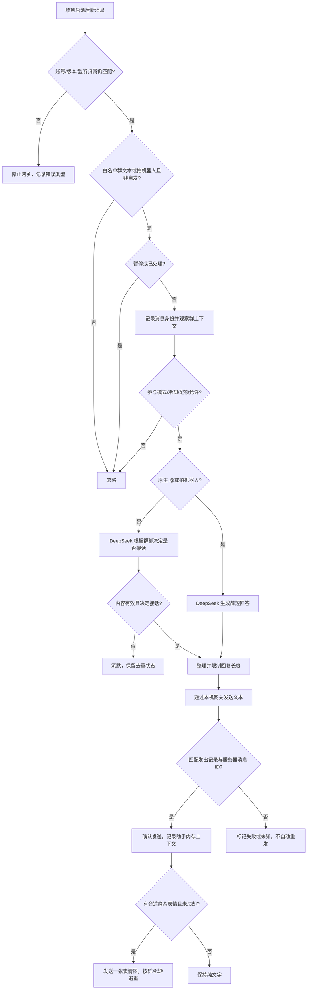

# 通用微信群聊天运行与验收流程

版本：0.2（2026-10-20）

关联需求：[requirements.md](requirements.md)

## 1. 当前状态

本机 native 基础读取、单次文本发送回执与原生 `@` 已核验，见 [接入记录](docs/wechatagent-integration.md)。持续网关现已接入 DeepSeek，真实 `@` 回复与自然接话均经用户收取和服务器回执确认，见 [文字聊天记录](docs/chat-acceptance.md)。当前为授权单群试运行，长期稳定性与掉线恢复仍需观察。

## 2. 本机准备与启动

1. 使用已核验的 Windows 微信与接入组件，确认账号、核心版本和回环监听归属。
2. 执行 `uv sync --extra native`，复制 `.env.example` 为 `.env`，填写 DeepSeek 密钥及本机参数。
3. 使用本机 `admin allow` 配置授权测试群。白名单外群和私聊不能进入模型上下文。
4. 执行 `uv run --extra native wechat-ai-bridge run --check`。它不调用模型、不发送消息；按只读检查结果补齐条件。
5. 配置有效密钥后运行 `uv run --extra native wechat-ai-bridge run`，保持进程运行。缺少密钥时拒绝真实聊天启动。
6. 启动时建立消息分片的当前游标，只接之后的新消息。`run --once` 仅轮询一次，不补答历史，不保持接收。

`ask` 只在本机模拟消息，不发微信。完整命令见 [README](README.md)。真实联调前告知群友必要上下文会发送至 DeepSeek。

## 3. 文字消息处理



原生提及元数据和经校验的拍机器人事件能触发直接回答，手打 `@名字` 或“拍一拍”仍是普通文本。拍一拍核对发起人、群和当前机器人目标，拍别人或自拍被忽略；不使用可编辑后缀作为模型指令。`mentions` 模式保留原生 `@` 和拍机器人，普通消息可用于群上下文，但不触发自然参与调用。默认自然模式克制接话；空回复与坏格式按沉默处理，沉默也去重。

每群默认共享最近 50 条双方发言。授权群的接收文本与确认发出的回复写入 SQLite `chat_history`，启动按原顺序恢复最近窗口，不按 10 分钟过期；完整存档不自动删除。恢复只作为背景，不触发补发或模型调用。成员采用稳定群内代号与可读微信昵称，user 消息用 API `name` 区分，保留当前说话人及历史回复目标。同名不合并、改名不换身份，只查询实际发送人的微信昵称，不读取联系人备注。发送失败或未知时不保存拟发助手内容。

用户记录与消息去重认领同事务；助手记录与确认投递同事务。撤销授权不删除存档，也不再加载；重新授权后可恢复本机已有记录。恢复条数用 `WECHAT_AI_BRIDGE_HISTORY_CONTEXT_MESSAGES` 配置 1～200，默认 50，重启生效。旧版未保存的历史不回填。启动状态中的 `historyRestored` 是恢复条数，`historyContextMessages` 是每群窗口上限，不包含正文。

默认原生 `@` 和拍机器人直接回应冷却 5 秒。普通消息先进入群上下文，在最后一条发言约 5 秒后合并判断；原生 `@` 或拍机器人取消该群待处理自然批次，避免额外重复插话。暂停或撤销群会清掉待处理批次，恢复时不补答；重启也不恢复内存待处理消息。每群每小时最多 60 次模型调用，配额包含沉默和失败。拍一拍刚入库尚无服务器编号时等待后续确认，不提前推进该分片游标。

启用场景表情包时，模型在同一次请求返回文字和已注册素材编号；只有文字发送并匹配服务器回执后才尝试发送一张静态图。素材准备或图片发送失败保留文字，不重发；每群默认 60 秒冷却、最近 5 张避重；暂停或撤群同样阻止配图。动图、微信原生收藏表情和聊天音频文件仍未接入。素材同步只读取公开索引，运行时按需下载并转为单帧 GIF；索引和 GIF 都在 Git 忽略目录。缓存前把长边缩放到 500 像素：微信会把宽度超过 1000 像素的 GIF 当文件发送，原生接口接受不等于显示成表情。

`@`/拍一拍回复启用语音条时，先用免费 Edge TTS 合成，播放到 VB-Cable 的 CABLE Input，临时把默认麦克风切到 CABLE Output，再把微信窗口置前并点击发送按钮左侧的语音图标开始/停止录音。只有目标群消息库出现新的自发 `local_type=34` 且 `server_id` 为正才确认；准备阶段失败回退文字，已经开始录音但状态未知时不补发。自然接话仍走文字。语音条要求微信窗口可见并短暂占用鼠标，不适用于无人值守的锁屏/后台场景。

自然参与决策使用受强制的 `decide_reply` 工具返回文字、沉默（`reply` 为空字符串）或表情编号；空回复是正常沉默，不记为 `model_response_empty`。决策工具参数损坏、缺失或截断才按可重试错误处理，最多重试一次；不再重复请求同一 JSON Output。

人设正文由 `config/persona.md` 按请求读取。保存内容即可更新，切换 `.env` 中的文件路径需要重启；显式内联 `WECHAT_AI_BRIDGE_SYSTEM_PROMPT` 优先。人设文件不得包含密钥，模型仅使用其文字内容，不执行文件中的指令作为管理员操作。

## 4. 管理与故障处理

本机终端提供 `admin allow/deny/pause/resume/status`。白名单与暂停动态生效；群聊不能修改配置。暂停后新消息不调用模型、不发送。

| 情况 | 处理 |
| --- | --- |
| 账号、核心版本或监听归属变化 | 停止网关，检查后重新启动 |
| 缺少模型密钥 | 拒绝真实聊天启动，在本机补齐配置 |
| 模型超时、空响应、坏 JSON 或暂时服务故障 | 配额允许且群仍启用时最多重试一次，两次失败后结束本条；错误类型与尝试次数写最少审计，下一条继续 |
| 模型认证、余额或配置错误 | 不重试，检查本机配置和服务账号 |
| 发送失败或回执未知 | 不记录虚假的助手回复，不自动重发，检查实际发出状态 |
| 接话过密或群友反馈不适 | 立即暂停，检查策略和限流，必要时改为仅 `@` 模式 |
| 移除测试群 | 本机 `admin deny` 后检查状态 |

运行记录只保留必要状态、用量、时间和错误类型。真实数据库、凭据、模型密钥、群名/群 ID 和聊天正文不进入公开文档或测试夹具；密钥和聊天正文不得写入持久日志。`run` 会在终端逐条临时打印收到的消息正文和发送结果（标准错误），仅供本机观察，禁止重定向保存或提交。

## 5. 文字阶段验收

```powershell
uv run --extra native --extra voice python -m unittest discover -s tests -v
git diff --check
```

`voice check` 只检查 Edge TTS、CABLE 设备、微信窗口和群名解析，不发送：

```powershell
uv run --extra native --extra voice wechat-ai-bridge voice check
```

真实联调仅在本机会话已授权的测试群进行，不在公开文档写实际群名/群 ID。

- [x] 本机已配置密钥，DeepSeek 真实请求成功。
- [x] `run --check` 只读检查符合实际运行条件。
- [x] 启动后的原生 `@` 得到一次文字回复，启动历史不补答。
- [x] 普通新消息已验证自然接话和沉默；多成员长场景仍待试运行观察。
- [ ] 同群上下文共享、匿名成员区分、跨群隔离与过期符合预期。
- [ ] 白名单、暂停、恢复、去重和模型调用限流实际生效。
- [x] 真实回复的服务器回执已确认；失败/未知不重复发送、不伪造助手上下文通过离线回归。
- [x] 场景表情包离线回归：素材索引/静态校验、文字与 `meme_id` 同次返回、群冷却与避重、文字确认后才配图、失败不重发。
- [x] 公开素材索引已同步 19 张，样图 083 真实下载并转为单帧 GIF；`run --check` 报告 `memeAssets=19`、`memeNativeReady=true`。
- [ ] 场景表情包真实群内发送与服务器回执验收（需在授权群现场观察）。
- [x] 语音条文件传输助手验证：Edge TTS、VB-Cable 路由、微信语音图标、`local_type=34` 回执，解码后非静音。
- [x] 语音条离线回归：@ 走语音、自然走文字、准备失败回退文字、未确认不补发。
- [ ] 语音条真实群内一次 @ 现场确认（需授权群和可见的微信窗口）。
- [x] 本次配置与数据库留在 Git 忽略目录，后台日志只记录状态和计数。

基础文字闭环已进入试运行。未勾选的多成员/跨群现场检查及长期运行项继续跟踪，不能将本次短时验证当作持续运行稳定性的结论。

## 6. 语音与唱歌

| 顺序 | 工作 | 状态与验收边界 |
| --- | --- | --- |
| 1 | 文字自由聊天 | 已通过真实闭环 |
| 2 | `@`/拍一拍语音条 | 已实现免费 Edge TTS + VB-Cable + 微信 PC 语音 UI；文件传输助手已确认 `local_type=34`，真实群内待一次 @ 现场确认 |
| 3 | 聊天音频文件/唱歌 | 尚未接入；Kits 翻唱短样为独立付费候选，不参与当前语音条链路 |

语音条和音频文件是两项能力；生成或发送音频文件不能当作已支持原生语音条。当前自然接话仍保持文字，只有 `@`/拍一拍走语音条。

## 7. QQ（NapCat + GPT-SoVITS，实验）

QQ 是独立进程，不与微信共用登录态或状态库。NapCat 负责 QQ 登录和 OneBot 11；本项目接收 HTTP POST webhook，发送 HTTP API 请求。语音由本机 GPT-SoVITS `api_v2.py` 生成 WAV，再以 OneBot `record` 消息段交给 NapCat 转 SILK。

```powershell
uv run --extra native wechat-ai-bridge qq check
uv run --extra native wechat-ai-bridge qq run
```

`qq check` 不发送消息；它检查 OneBot 登录、webhook 端口、群数量和参考音频。真实验收需要：测试小号、测试群、NapCat HTTP 服务 + webhook、GPT-SoVITS 服务。详细步骤见 [QQ 接入说明](docs/qq-gpt-sovits.md)。

- QQ 模型通过 `decide_reply.voice` 选择文字或语音；GPT-SoVITS 失败/超时回退文字，发送状态未知不自动重试。
- QQ 私聊用 `QQ_ALLOWED_PRIVATE_USERS` 显式白名单；未列出的好友不响应。私聊消息直接回答，文字走 `send_private_msg`，语音走 `send_private_msg` 的 `record` 段。
- 微信私聊用 `gateway.json` 的 `allowedPrivateIds`；只发文字，不走群语音/看图。
- NapCat 是个人号非官方协议，存在账号风控；只用测试小号，不暴露 webhook 到公网。
- 离线测试不能证明 QQ 语音条显示；必须现场确认 NapCat 转 SILK 后的形态。
