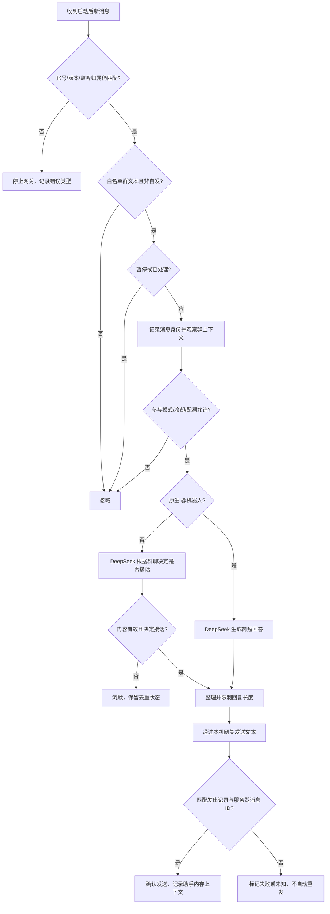

# 通用微信群聊天运行与验收流程

版本：0.2（2026-10-20）

关联需求：[requirements.md](requirements.md)

## 1. 当前状态

本机 native 基础读取、单次文本发送回执与原生 `@` 已核验，见 [接入记录](docs/wechatagent-integration.md)。持续网关现已接入 DeepSeek，真实 `@` 回复与自然接话均经用户收取和服务器回执确认，见 [文字聊天记录](docs/chat-acceptance.md)。当前为授权单群试运行，长期稳定性与掉线恢复仍需观察。

## 2. 本机准备与启动

1. 使用已核验的 Windows 微信与接入组件，确认账号、核心版本和回环监听归属。
2. 执行 `uv sync --extra native`，复制 `.env.example` 为 `.env`，填写 DeepSeek 密钥及本机参数。
3. 使用本机 `admin allow` 配置授权测试群。白名单外群和私聊不能进入模型上下文。
4. 执行 `uv run --extra native wechat-ai-bridge run --check`。它不调用模型、不发送消息；按只读检查结果补齐条件。
5. 配置有效密钥后运行 `uv run --extra native wechat-ai-bridge run`，保持进程运行。缺少密钥时拒绝真实聊天启动。
6. 启动时建立消息分片的当前游标，只接之后的新消息。`run --once` 仅轮询一次，不补答历史，不保持接收。

`ask` 只在本机模拟消息，不发微信。完整命令见 [README](README.md)。真实联调前告知群友必要上下文会发送至 DeepSeek。

## 3. 文字消息处理



只有原生提及元数据能触发直接回答，手打 `@名字` 是普通消息。仅 `@` 模式下，普通消息可用于群上下文，但不触发自然参与调用。默认自然模式克制接话；空回复与坏格式按沉默处理，沉默也去重。

每群共享最多 20 条、最长 10 分钟的内存上下文。模型中的成员使用群内匿名代号，只使用该白名单群必要内容。群间隔离，不保存完整聊天档案。发送失败或未知时不将拟发内容当作已经说过的话。

默认原生 `@` 冷却 5 秒，自然评估至少间隔 30 秒，每群每小时最多 60 次模型调用。暂停、冷却和配额优先于回答请求。

## 4. 管理与故障处理

本机终端提供 `admin allow/deny/pause/resume/status`。白名单与暂停动态生效；群聊不能修改配置。暂停后新消息不调用模型、不发送。

| 情况 | 处理 |
| --- | --- |
| 账号、核心版本或监听归属变化 | 停止网关，检查后重新启动 |
| 缺少模型密钥 | 拒绝真实聊天启动，在本机补齐配置 |
| 模型超时、额度不足或输出无效 | 结束本次处理，记录错误类型，避免重复调用/刷屏 |
| 发送失败或回执未知 | 不记录虚假的助手回复，不自动重发，检查实际发出状态 |
| 接话过密或群友反馈不适 | 立即暂停，检查策略和限流，必要时改为仅 `@` 模式 |
| 移除测试群 | 本机 `admin deny` 后检查状态 |

运行记录只保留必要状态、用量、时间和错误类型。真实数据库、凭据、模型密钥、群名/群 ID 和聊天正文不进入公开文档或测试夹具；密钥和聊天正文不得进入运行日志。

## 5. 文字阶段验收

```powershell
uv run --extra native python -m unittest discover -s tests -v
git diff --check
```

真实联调仅在本机会话已授权的测试群进行，不在公开文档写实际群名/群 ID。

- [x] 本机已配置密钥，DeepSeek 真实请求成功。
- [x] `run --check` 只读检查符合实际运行条件。
- [x] 启动后的原生 `@` 得到一次文字回复，启动历史不补答。
- [x] 普通新消息已验证自然接话和沉默；多成员长场景仍待试运行观察。
- [ ] 同群上下文共享、匿名成员区分、跨群隔离与过期符合预期。
- [ ] 白名单、暂停、恢复、去重和模型调用限流实际生效。
- [x] 真实回复的服务器回执已确认；失败/未知不重复发送、不伪造助手上下文通过离线回归。
- [x] 本次配置与数据库留在 Git 忽略目录，后台日志只记录状态和计数。

基础文字闭环已进入试运行。未勾选的多成员/跨群现场检查及长期运行项继续跟踪，不能将本次短时验证当作持续运行稳定性的结论。

## 6. 后续语音与唱歌

| 顺序 | 工作 | 验收边界 |
| --- | --- | --- |
| 1 | 文字自由聊天 | 通过上述真实闭环 |
| 2 | 语音合成 | 得到可播放音频，验证音色、延迟与费用 |
| 3 | 微信原生语音条发送 | 接收端显示/播放原生语音条，核验发送确认和失败行为 |
| 4 | 唱歌生成与发送 | 明确生成服务及发送形式，核验唱歌质量与完整链路 |

语音文件和微信原生语音条分别验证；上传音频附件不等于发送原生语音条。后续能力当前均不作为已支持功能。
