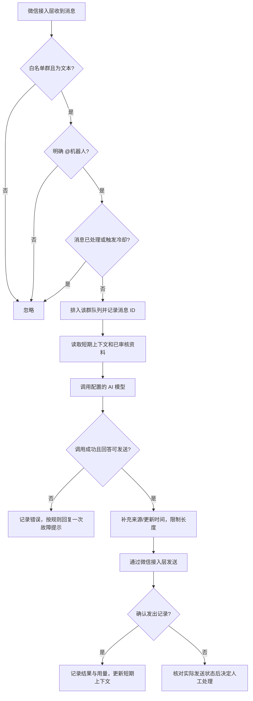
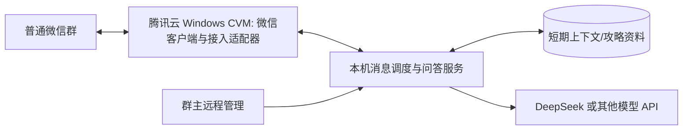

# 《燕云十六声》微信群 AI 助手流程草案

版本：0.1（2026-10-19）  
关联需求：[requirements.md](requirements.md)

## 1. 群消息处理流程

约束：机器人不回答它自己发送的消息；群友消息和检索网页中的“忽略上述规则”等文字只能当作资料，不得变成配置指令。发送状态未知时不直接重发。

## 2. 管理与资料更新流程

1. 群主在本机/服务器管理界面修改白名单、模型配置或攻略资料。
2. 配置先校验格式与权限；资料必须附来源、采集日期或适用游戏版本。
3. 保存为新版本并留回滚点，再让问答服务加载。
4. 用固定问题检查新资料；若答案退化，恢复上个版本。
5. 暂停开关优先于所有自动回复规则，紧急时可立即停止发送。

管理配置不通过群聊自然语言修改，避免群友误触或提示词注入。

## 3. 从原型到腾讯云的实施流程

| 阶段 | 工作 | 通过条件 |
| --- | --- | --- |
| 0. 接入验证 | 在本机 Windows 准备授权的微信客户端与可用接入组件，使用测试账号和测试群收发 | 实际登录、读取、发送、去重成功；确认账号与平台风险 |
| 1. 问答原型 | 独立实现消息调度、资料库、DeepSeek 模型适配和手工测试入口 | 不连接微信也能测试核心问答；资料不足时不编造 |
| 2. 本机联调 | 接入微信适配器；只放行一个测试群的 @ 消息 | 连续试运行，检查重复消息、失败恢复、费用、群友体验 |
| 3. 云端准入 | 建腾讯云 Windows 候选实例，限制管理入口，安装运行环境并做微信登录试验 | 目标实例可登录匹配微信；断开远程桌面和重启后仍能收发；故障可恢复 |
| 4. 迁移上线 | 迁移加密配置和资料，切换测试账号运行位置，保留回退路径 | 白名单、密钥、消息去重状态正确；群主验收后扩大使用 |

**云端准入失败时**：微信网关继续留在本机 Windows，腾讯云只运行问答服务；两端通过带认证的私有连接通信。不可将未经验证的桌面微信进程当作无界面 Linux 服务部署。

## 4. 腾讯云候选部署结构

- 微信与接入适配器使用本机回环地址通信，不把 Hook 接口暴露公网。
- 云服务器仅开放必要管理入口，并限制来源 IP；模型 API 使用出站 HTTPS。
- 配置、资料和少量状态定期备份；密钥与备份分开保管。
- 不承诺 Windows Server 上的特定微信版本天然可用；以阶段 3 实测结果为准。

## 5. 故障与回退

| 故障 | 系统动作 | 群主动作 |
| --- | --- | --- |
| 微信掉线或版本不匹配 | 停止发送、记录健康状态，不反复强推登录 | 检查账号状态及兼容版本 |
| AI 服务超时/额度用尽 | 不重试同一问题造成刷屏；必要时回复一次故障提示 | 切换模型或补充额度 |
| 资料过时/答案被质疑 | 标记来源和更新时间，允许撤回资料版本 | 审核并更新攻略 |
| 群内刷屏/误触发 | 群级冷却、队列和暂停开关生效 | 调整白名单或暂停 |
| 云端微信不能维持会话 | 暂停云端微信网关 | 回退本机网关，云端保留问答服务 |

## 6. 上线前检查清单

- [ ] 群主同意测试群和机器人账号的使用方式。
- [ ] 群友已获知触发消息会送往云端 AI 服务。
- [ ] 微信接入组件、客户端版本及授权来源完成核验。
- [ ] 白名单、@ 触发、去重、冷却、暂停、错误恢复均通过实测。
- [ ] API 密钥未写入仓库或日志，管理入口限制访问。
- [ ] 已做云端登录、断开远程桌面、重启恢复和回退演练。
